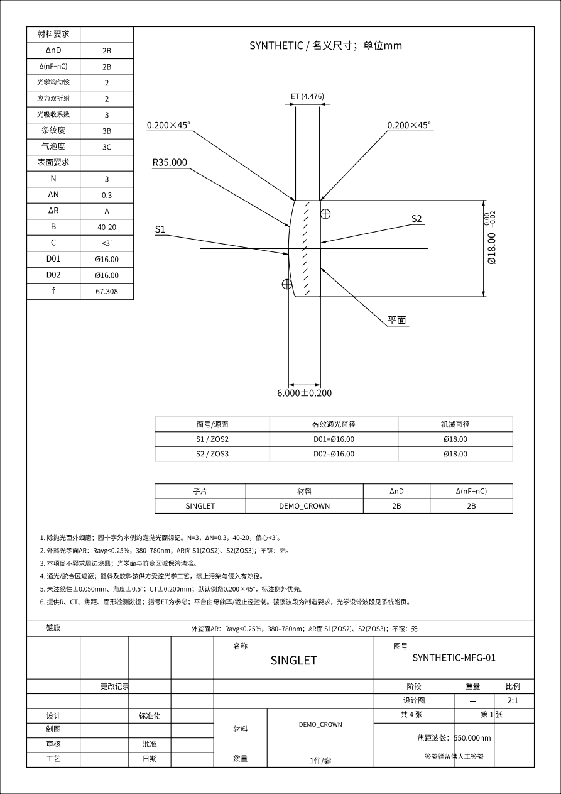
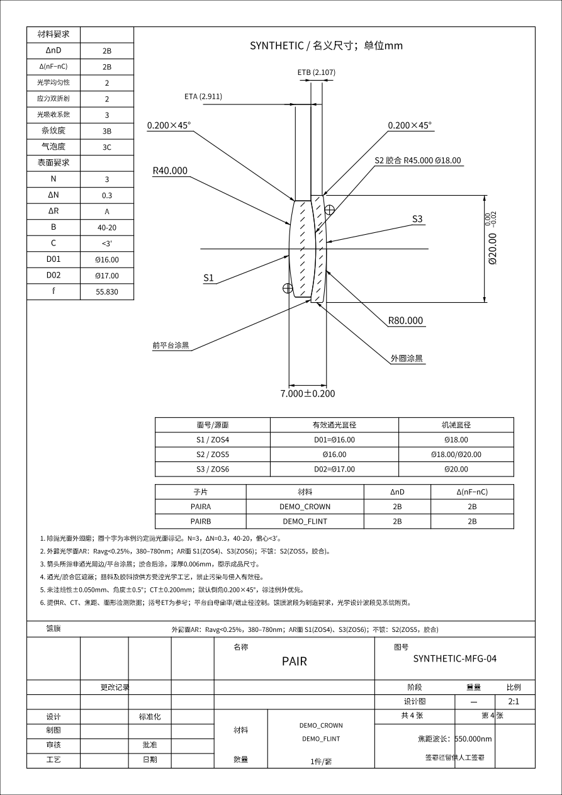
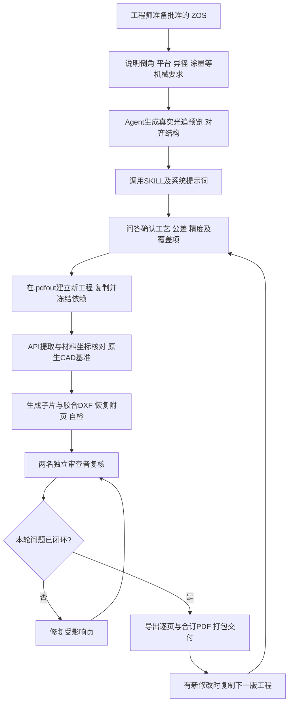

# Optical Manufacturing Drawings

**给光学工程师的 Agent 出图工作流：从已确定的 `.ZOS` 和机械补充要求，制作镜片制造 DXF、逐页 PDF 与合订图纸。**

MIT 开源；中文工作流，English CLI。概念、脚本、通用图框、示例和系统提示词均在包内，不依赖其他 skill 或作者的本机上下文。

## 出图示意

以下图片直接由本包生成的 PDF 渲染，使用虚构材料和合成处方，展示单片与异径双胶合的标注效果。

| 单片制造图 | 双胶合总图 |
|---|---|
|  |  |

[查看四页示例 PDF](docs/previews/complete.pdf) · [正片子图](docs/previews/PAIR_A.png) · [负片子图](docs/previews/PAIR_B.png)

双胶合的交付包含**两张子片制造图＋一张胶合总图**，不是只出总图。示例只用于展示和回归，不作为实际加工订单。

## 工程师与 Agent 各自负责什么

| 角色 | 职责 |
|---|---|
| 工程师 | 提供已确定的光学设计；明确倒角、平台、异径胶合、装夹等机械意图；确认工艺、公差和验收条件；作最终制造放行判断 |
| Agent ＋本 SKILL | 读取源模型、核对面号/材料/坐标；把补充要求整理成机械定义；生成光追预览、制造图和恢复附页；执行自动检查、独立复核和版本归档 |
| Zemax / ZOSAPI | 提供光学处方、实际材料解析、追迹与原生 CAD 基准；复杂机械边缘可以由独立机械定义补充 |

本 SKILL 不自行优化你的光学设计，不将“图纸生成成功”当作像质或量产良率证明。当前工具覆盖同轴 Standard 球面/平面单片与双胶合；偏心、反射、多配置、非球面等先确认适配范围，见 [能力说明](references/api-alignment.md)。

## 使用步骤

### STEP 1：准备好 `.ZOS`

提供本次批准的设计版本，并说明建模方向、工作波段、端面身份和出图范围。源文件作为基准保留，不在原件上改图。在线提取需要 Windows、已安装且有许可的 OpticStudio 和 ZOSPy；环境要求见 [安装说明](references/environment.md)。

### STEP 2：告诉 Agent，ZOS 无法完整体现哪些机械要求

例如：倒角宽度/角度、母曲面截止、外圈平台、异径胶合两侧外径、涂墨区域、装夹余量。可以直接描述意图，由 Agent 整理成 `mechanical.json`；你不需要先手写完整 JSON。

**要求 Agent 先用光线追迹图片预览并解释结构。** 图中应能辨认各子片、胶合界面、机械外轮廓与通光范围，说明平台/倒角等与 ZOS 简化边缘的差异。包内 `system_layout.py` 可用真实 ZOS 追迹并叠加机械轮廓；仅有静态快照且不含光线时，不能把它称为光追预览。

```text
请先检查 design.zos。L2采用异径胶合，正片外径小于负片；负片胶合外圈做平台。
倒角和涂墨范围按我的补充要求整理为机械定义，不改变有效光学区。
请先生成带真实追迹光线的整体预览，解释子片编号、平台和倒角，再进入制造出图。
```

### STEP 3：调用本 SKILL，附带系统提示词

将本包加载为 agent skill，入口是 [SKILL.md](SKILL.md)。配套 [系统提示词](prompts/system.md) 可放入 Agent 的 system/developer instruction；若工具不支持自定义系统提示词，也可与任务一起提供。

```text
请使用 optical-manufacturing-drawings/SKILL.md，
并按 optical-manufacturing-drawings/prompts/system.md 执行。
输入是 design.zos 和刚才确认的机械要求，工作目录为当前目录。
先进入问答session确认工艺、公差和精度，再生成本轮冻结工程和完整图纸包。
```

### STEP 4：问答 session，确认工艺、公差与精度

Agent 首先询问 **“本次是否按照默认公差要求出图？”**，展示默认值并记录你的答复。确认内容包括：周边/平台是否涂黑、镀膜面和波段、材料允差、中心厚/外径公差、表面质量、倒角、有效径和显示精度。已有明确答案可引用并记录，不反复索要批准；必要的未给值集中补问。

**默认精度参考恒洋光学货架镜片的默认精度，并结合本工作流的项目约定作了调整**（来源说明由维护者提供）。实际执行值见 [默认精度与来源说明](references/default-precision.md)、[配置 JSON](assets/drawing-defaults.json)。它们是可修改的起点，不表示所有字段都是厂商统一标准，也不替代具体订单或光学公差分析。

| 当前默认项目 | 数值/做法 |
|---|---|
| 直径公差 | `0.00 / −0.02 mm` |
| 中心厚度公差 | 子片 CT ≤ 2.000 mm：`±0.100 mm`；其余子片和胶合总厚：`±0.200 mm` |
| 未注线性 / 角度 | `±0.050 mm` / `±0.5°` |
| 图面位数 | 直径两位；R、CT、ET、倒角线性尺寸和焦距三位 |
| 材料允差 | `ΔnD=2B`、`Δ(nF−nC)=2B` |
| 表面要求 | `N=3`、`ΔN=0.3`、`40-20`、偏心 `<3′` |
| 倒角 | `0.200×45°`，受通光或局部斜率限制时明确例外 |
| 工艺 | 非通光周边/平台涂黑；外露光学面 AR `380–780 nm, Ravg<0.25%`，胶合面不套空气侧AR |

### STEP 5：冻结、出图、复核、交付

每次正式出图批次都先在工作目录 **`.pdfout/` 新建工程并复制依赖**。源 ZOS、原始机械定义、图框、脚本和确认记录可追溯；Agent 在副本中执行。

完成带框 DXF 后，Agent 报告进入复核。两名独立审查者分别结合整体图、原生 CAD 和直接 API 核对；修复后只检查受影响页。回建的光线比较由脚本完成，人只看差异摘要和异常索引。最后导出逐件/合订 PDF，检查字形、纸幅、比例和完整性，附真实复核记录交付。

## Workflow



## 默认交付文件结构

下面是首次完整出图的典型结构。`freeze_project.py` 负责冻结工程，`drawctl` 管理图纸产物；原生CAD、整体图、恢复附页和回建文件由 Agent 按任务补齐，不是仅运行 `init` 就已经完成。

```text
工作目录/
├─ design.zos                       # 你的原件，保留
├─ mechanical.json                  # Agent整理并与你对齐的机械定义
└─ .pdfout/
   └─ <时间>_initial_<id>/
      ├─ frozen-manifest.json       # 初始文件/依赖哈希
      ├─ inputs/                    # 原始ZOS和机械定义的冻结副本
      ├─ skill/                     # 本轮使用的完整skill版本
      ├─ local-fonts/               # 本地字体依赖，不自动分发
      ├─ dependencies/              # 本轮参考资料（如有）
      ├─ archive/                   # API提取与派生数据（首次建档）
      └─ project/
         ├─ project.json            # 页清单、图面配置、公差覆盖与确认记录
         ├─ inputs/                 # 冻结快照、图框、恢复附页DXF
         ├─ evidence/               # API证据、原生CAD、整体图及回建证据
         ├─ dxf/                    # 单片/胶合子片/胶合总图
         ├─ preview/                # DXF回读预览PNG
         ├─ review/                 # 复核请求、报告和版本绑定记录
         ├─ proof_pdf/              # 复核前试印，可供检查
         ├─ pdf/                    # 最终逐页PDF、预览及complete.pdf
         ├─ build-state.json        # 增量缓存与产物指纹
         └─ delivery.zip            # 当前清单的制造交付包
```

ZOS负责光学事实，机械JSON补足复杂边缘。图纸包以可读附页记录恢复所需参数；不要求工程师手动维护多份独立光学处方。包内工具不会伪造签署或把未完成的复核标为通过。

## 改版和增量更新

告诉 Agent 上一版 `project.json` 和本次改动，例如“移动L2B的S1引线”“将该子片CT公差改成±0.100”。**先复制上一版工程，再修改新副本。**

```text
.pdfout/
├─ <时间1>_initial_<id>/            # 上一版保留
└─ <时间2>_label-edit_<id>/         # 本次新工程
   ├─ frozen-manifest.json
   ├─ previous-frozen-manifest.json
   ├─ frozen_original_project.json
   ├─ inputs/                     # 原始设计和机械要求继续继承
   ├─ dependencies/               # 原有参考继续继承
   ├─ added_dependencies/         # 新增参考（如有）
   ├─ skill/                      # 本轮工具版本
   ├─ local-fonts/
   └─ project/                    # 配置、同源证据及缓存的副本
      ├─ project.json
      ├─ dxf/、preview/、pdf/      # 只重出需要更新的页
      ├─ evidence/、review/
      ├─ build-state.json
      └─ delivery.zip             # 本轮重新打包
```

- 仅标注/公差/排版变化：复用同源 API、CAD、回建证据和未变页缓存，双人复核变化页。
- 光学处方/机械几何变化：重新提取并更新受影响的几何与验证证据；不拿旧快照冒充新模型。
- 更新 skill、模板或字体：相关依赖签名改变，会重建受影响产物。

命令与参数见 [增量使用](references/fast-execution.md)，完整工序见 [执行工序](references/execution-workflow.md)。

## 有效性与提示词改进

维护者已确认完整工作流在以下环境中通过：

- **Codex + 6.0astra**
- **Pi agent + deepseek flash 4.1-1017，max**

该确认针对已测试的工序与样件，不代表任意光学系统可免复核出图。公开包另外提供可运行的合成回归，便于更换模型、改进 [SKILL](SKILL.md) 或 [系统提示词](prompts/system.md) 后自行确认。

**修改提示词后，建议让 Agent 用 sample 重新出图并检查结果。** 用 `make_example.py` 生成可制图的合成单片/胶合样例，运行下面的离线流程，查看四页新 PDF，并核对材料、S面号、CA/机械径、倒角/平台、ET、涂墨、字形和纸面比例；再测试一次单页增量更新。保留模型、提示词版本、实际耗时和问题记录，不只比较“是否执行成功”。

注意：[脱敏 ZOS/ZMX sample](samples/README.md) 是零间距、空材料、打乱面的**解析测试文件**，只用于加载/读取，不适合验证制造出图。图纸回归应使用下面的可用合成几何，或你自己获准使用的有效 ZOS＋机械定义。

## 离线 sample 出图（不需要 Zemax）

Python 3.10+，建议3.11及独立虚拟环境；字体自行提供，需覆盖中文和工程符号。

```sh
python -m pip install -r requirements.txt
python scripts/make_example.py --out demo-archive
python scripts/drawctl.py init --archive demo-archive --out demo-project --title DEMO --font /path/to/CJK-font.ttf
python scripts/drawctl.py build demo-project/project.json
python scripts/drawctl.py pdf demo-project/project.json --proof
python scripts/system_layout.py --snapshot demo-archive/source/synthetic_source.json --mechanical demo-archive/data/mechanical.json --out demo-layout.png
```

一条回归入口：`python tests/smoke.py --font FONT --workdir EMPTY_DIR`，检查离线链、工程搬迁、缓存、符号和打印比例。合成产物只作proof，不解锁真实制造发布。首次真实工程冻结命令：

```sh
python scripts/freeze_project.py --workdir WORK --source design.zos --mechanical mechanical.json --font FONT --label initial
```

## 发行和许可证

本包自有源码、文档、通用图框和合成示例适用 [MIT](LICENSE)。外部依赖保留各自许可，见 [第三方说明](THIRD_PARTY.md)。字体、OpticStudio、玻璃库和真实客户数据不随包提供。

`scripts/release.py --out DEST.zip` 打包公开源码与明确列入的合成示意；`drawctl pack` 打包具体工程的制造交付，可能包含你的设计数据，**不要把后者当作开源发布包**。
